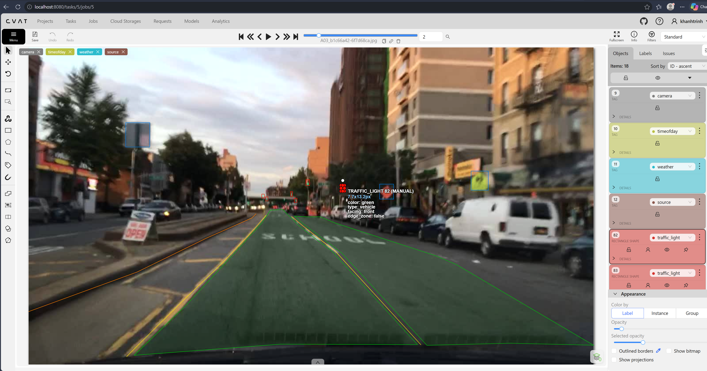
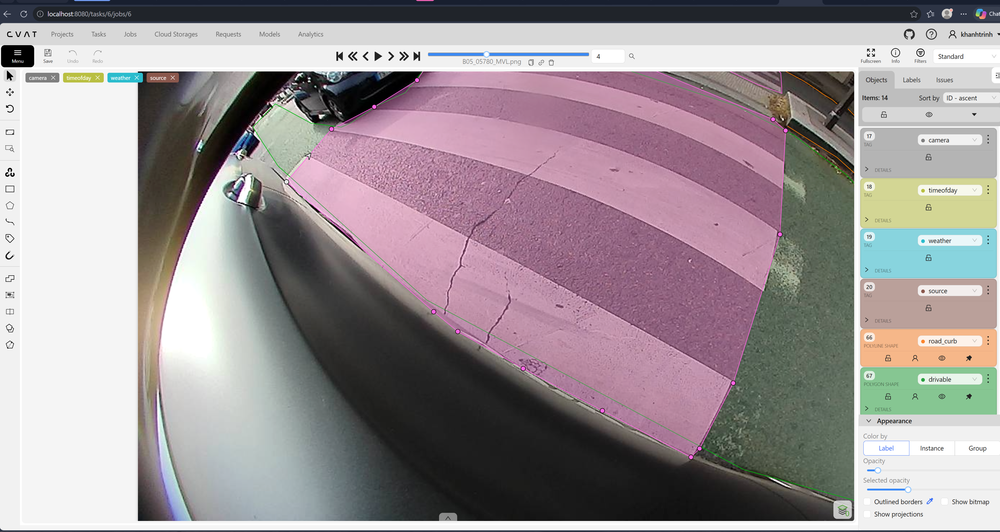
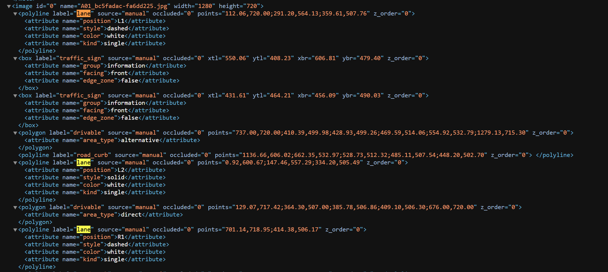

# Báo cáo cá nhân — Ngày 11
Họ tên: Trịnh Vinh Khánh          
Mã học viên: 2A2092603220

Phiên bản CVAT (Help → About): 2.74.1

Guideline: Road v1.0    
Lần nộp (`revision` trong manifest): 2  
Thời điểm export (ngày giờ trên CVAT): Nov 21st 26, 23:50    
Số lần nộp lại sau Rework: 1 

## 1. Kiểm project
| Mục | Đúng như guideline Road v1.0? | Ghi chú |
| --- | --- | --- |
| 6 label, đúng kiểu | lane, road_curb, crosswalk, drivable, traffic_light, traffic_sign |  |
| Thuộc tính và giá trị | polyline (lane, road_curb), polygon(crosswalk, drivable), rectangle (traffic_light, traffic_sign) |  |
| 4 tag ảnh | camera, timeofday, weather, source |  |
Cách kết thúc polyline trên bản CVAT này:  | Bấm phím N để kết thúc. |
Cách đặt tag ảnh trên bản CVAT này:  | Dùng công cụ Tag ở thanh bên trái. Đặt camera trước, sau đó timeofday, weather, source. Trong bảng Objects, mở Details của từng tag để kiểm giá trị. |


## 2. Số lượng đã gán
| Task | Ảnh | lane | road_curb | crosswalk | drivable | traffic_light | traffic_sign |
|---|---:|---:|---:|---:|---:|---:|---:|
| front | 12 | 24 | 6 | 9 | 23 | 33 | 26 |
| front-extra (đã làm 4 / 4) | 4 | 11 | 1 | 5 | 9 | 13 | 10 |
| fisheye | 8 | 7 | 14 | 9 | 9 | 2 | 1 |
| fisheye-extra (đã làm 4 / 4) | 4 | 1 | 1 | 4 | 2 | 0 | 0 |

## 3. Bảng ca khó
| Ảnh | Nhãn | Phân vân giữa | Đã chọn | Lý do |
| --- | --- | --- | --- | --- |
| A05 | drivable | có nên polygon toàn bộ đường là drivable không? | chọn drivable cho toàn bộ đường | không có vạch phân làn nên vùng đuòng vẫn thuộc vùng có thể đi của phương tiện |
| A06 | drivable | có nên polygon làn đường bên phải là drivable không? | chọn drivable | Đối chiếu với làn đối diện khi xe vẫn đi cùng chiều nên khu vực đó drivable. |
| A09 | lane | có nên gán cho dải phân cách cong ở làn bên cạnh không? | không gán | Ảnh có xe đi ngược chiều trong làn và không đủ căn cứ để xác định đó là làn xe đi được |


## 4. Phiếu QC 1 nhận được
Bạn kiểm lô của tôi:  Quyết định nhận được:  
| Mã lỗi | Số lỗi | Đồng ý? | Đã sửa? |
| --- | ---: | --- | --- |
| QC1-03 | 4 | có | Đã sửa |


## 5. Kiểm file export

| File | Mở lại được? | Số shape ảnh 1 (job / file) | Số shape ảnh 2 (job / file) | Tag camera có trong XML? |
|---|---|---|---|---|
| trinhvinhkhanh-front.zip | Có | A01: job 14 / file 10 | A02: job 11 / file 7 | Có (camera, source, timeofday, weather) |
| trinhvinhkhanh-fisheye.zip | Có | B01: job 8 / file 4 | B02: job 7 / file 3 | Có (camera, source, timeofday, weather) |
## 6. Ảnh chụp màn hình
1. Tab Labels của project.

2. Một ảnh camera trước đã gán đủ (làn, vùng lái, đèn/biển).

3. Một ảnh fisheye đã gán, phóng to đoạn polyline cong.


4. Một đoạn XML có <polyline label="lane">.


## 7. Tự đánh giá
Lỗi bạn mắc nhiều nhất hôm nay (theo mã QC1-xx), và cách tránh ở Ngày 20:  
Nhãn của bạn đi vào model ở đâu? Chọn một lỗi đã sửa và nói nó làm model học sai thế nào:  
```
Lỗi mắc nhiều nhất là chọn nhầm là
- Thiếu L1, L2, R1, R2 cho Lane
- Đèn, biển có tâm hộp nằm ngoài 80 % bán kính vòng ảnh.

Cách Phòng tránh:
- Kiểm tra, đối chiếu vị trí trái/phải từ góc nhìn.
- Thêm edge_zone cho tâm box trong 80 % bán kính

Nhãn đi vào model qua chuỗi: 
Nhãn gán trên CVAT rồi export `annotations.xml`, người nhận chuyển sang định dạng huấn luyện, sau đó nhãn được dùng để tính loss khi train. 

Trong ảnh A01, lúc gán vạch bên phải xe là L1 thay vì R1. Nếu để nguyên, model sẽ học rằng vạch bên phải là vạch bên trái, nên khi suy luận trên cảnh tương tự, nó có thể xác định sai phía làn và đưa ra quyết định lái lệch về hướng ngược lại. Sau khi sửa thành R1, nhãn khớp với thực tế và model học đúng quan hệ vị trí giữa xe và hai vạch.
```
## 8. (Tùy chọn, buffer) Từ polyline đến đích row-anchor
| y | 720 | 680 | 640 | 600 | 560 |
| --- | ---: | ---: | ---: | ---: | ---: |
| x của chúng tôi |  |  |  |  |  |
| x của bạn kia |  |  |  |  |  |

Trả lời 3 câu:

1. Năm số x đó chính là đích mà một model row-anchor học cho vạch này. Nếu bạn dừng polyline sớm 40 px, hàng nào đổi thành "không có làn"?
2. So với bạn được kiểm (cùng ảnh): ở hàng 720 và hàng 560, hai bạn lệch nhau bao nhiêu pixel? Lệch ở hàng nào ảnh hưởng LKA nhiều hơn (slide 25)?
3. Nếu polyline vẽ từ xa về gần (ngược quy tắc 2), cách tính trên có đổi không? Script nào sẽ gặp khó?
